# Docket

**Who can change a NEAR account without a vote, read from the chain alone.**

**Live: [doc-ket-project.vercel.app](https://doc-ket-project.vercel.app)** · try
[meta-pool.near](https://doc-ket-project.vercel.app/account?account=meta-pool.near),
[Burrow's proposals](https://doc-ket-project.vercel.app/docket?dao=burrow.sputnik-dao.near&from=1741&limit=4),
[the register](https://doc-ket-project.vercel.app/register)


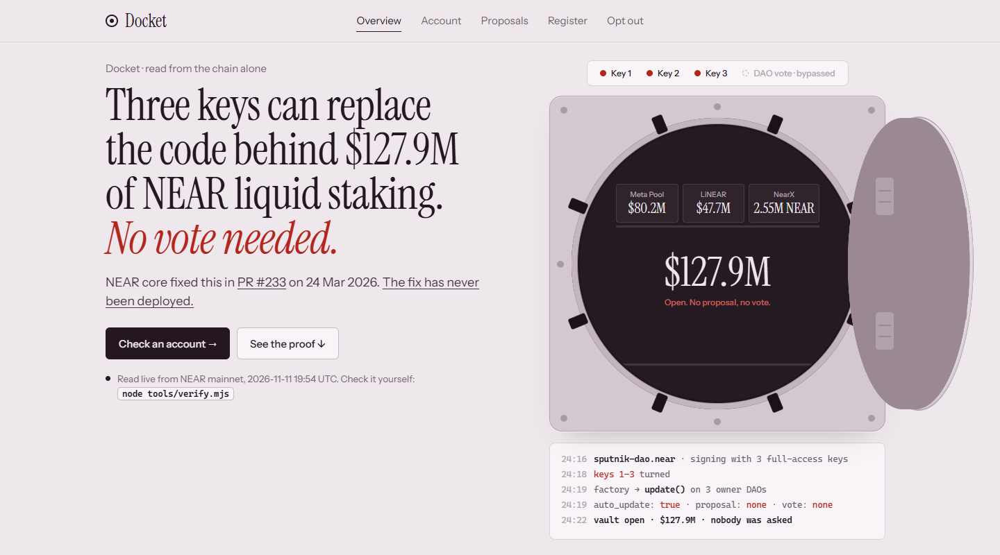

<sub>The homepage, read live on 2026-11-09 18:28 UTC. The dollar figure is DefiLlama's at the moment of the read, so it moves; the spec's dated figure is $126.7M (2026-11-06).</sub>

Docket follows every path by which an account's code or rules can change: its
access keys, its owner, the global contract it runs, and, for a Sputnik DAO, the
factory and the DAO's voting policy. It reads public view calls and nothing
else. It holds no key, needs no account and signs nothing. The one exception is
the optional delegate (below): it signs its own votes with a key that can do
nothing else.

| | |
|---|---|
| **3** | full-access keys on `sputnik-dao.near`, the only authority over the factory |
| **1,607 of 2,086** | Sputnik DAOs read `auto_update: true`: the factory can replace their code with no vote (census 2026-11-07) |
| **$126.7M + 2,553,885 NEAR** | behind the three DAOs that own Meta Pool, LiNEAR and NearX (DefiLlama 2026-11-06; NearX from chain) |
| **13** | DAOs have opted out; one proposal does it, and Docket drafts it |
| **PR #233** | the fix, merged 2026-03-24, still not in the factory's default build (read live) |
| **0** | dependencies to verify it: `node tools/verify.mjs` re-reads every claim from mainnet |

---

## Contents

- [What it found](#what-it-found)
- [Run it](#run-it)
- [The site](#the-site): five pages, five diagrams
- [How it works](#how-it-works): architecture, reads, invariants
- [The fix: opting out](#the-fix-opting-out)
- [The delegate](#the-delegate-an-ai-voter-that-cannot-vote-past-a-flag)
- [Tools](#tools)
- [What has been run on mainnet](#what-has-been-run-on-mainnet)
- [Repository layout](#repository-layout)
- [How this was built](#how-this-was-built)
- [NEAR HACKATHON](#near-hackathon): window, tracks, what to run

---

## What it found

A Sputnik DAO's contract has a function, `update()`, that is not a proposal.
While the DAO's `auto_update` setting is `true`, **which is the default**, the
factory `sputnik-dao.near` can use it to replace the DAO's code with no vote.
The factory owns itself, so its only authority is its **three full-access
keys**. The DAOs that administer Meta Pool, LiNEAR and NearX all read `true`.

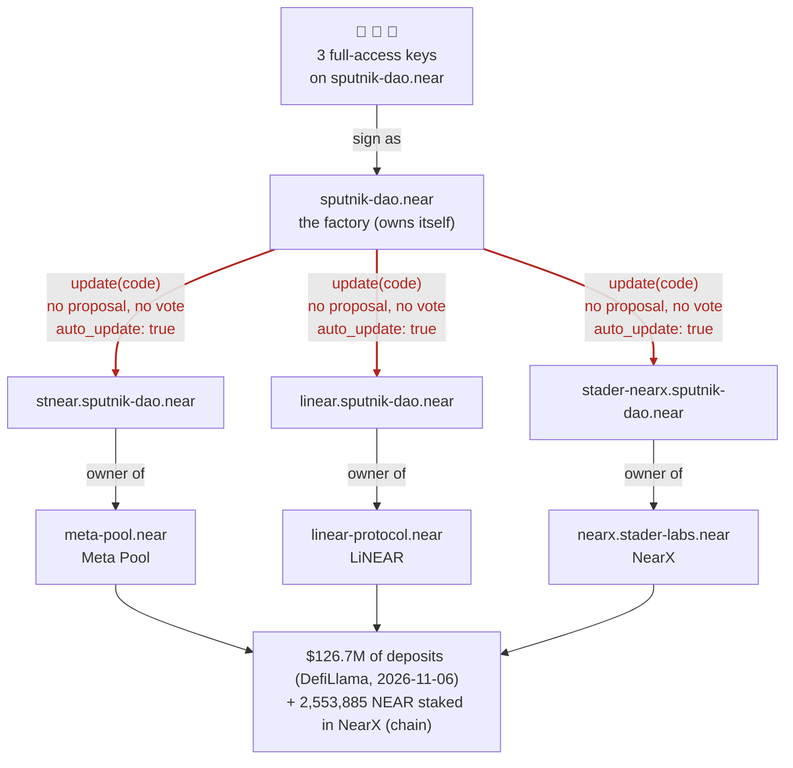

Every edge in that chart is a public view call, and `node tools/verify.mjs`
re-reads every one of them.

**The vote that can be skipped.** A DAO has two routes to new code. Members
see only the first:

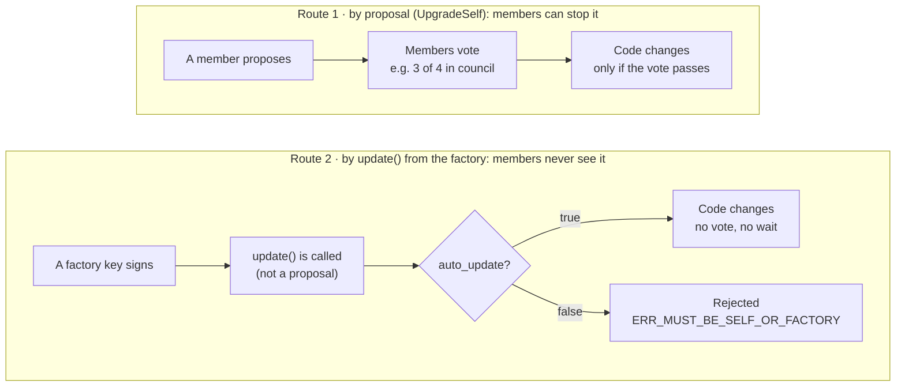

**The fix exists and is not deployed.** NEAR core fixed this in
near-daos/sputnik-dao-contract **PR #233**, merged 2026-03-24 (an `UpgradeSelf`
proposal with a two-week delay). The factory still publishes build
`2b0f34a38604` as its default, which predates the fix. So this is reporting,
not disclosure: Docket shows who is exposed until the fix ships, and drafts the
one proposal that closes the gap today.

**It is not one vault.** Of the 2,086 DAOs the factory lists (census,
2026-11-07):

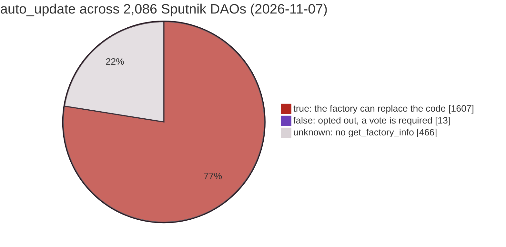

The full argument, with every number sourced and dated, is in
[ARCHITECTURE.md](ARCHITECTURE.md). Claims that were wrong in earlier drafts,
and how they were caught, are kept in its §12.

---

## Run it

Node 22 or later. Nothing to install: there are no dependencies.

```bash
node tools/verify.mjs
```

This prints the chain, from the factory's three keys down to the protocols and
the value behind them, and then re-reads every claim the spec says it re-reads
from NEAR mainnet, GitHub and DefiLlama:

```
§3.4  the chain — every edge a public view call, read in this run

  3 full-access keys on sputnik-dao.near   [get_owner -> sputnik-dao.near (self-owned)]
   └── update(code) → DAO update(), no vote: auto_update: true on
        ├── stnear.sputnik-dao.near        owner of meta-pool.near
        ├── linear.sputnik-dao.near        owner of linear-protocol.near
        └── stader-nearx.sputnik-dao.near  owner of nearx.stader-labs.near
```

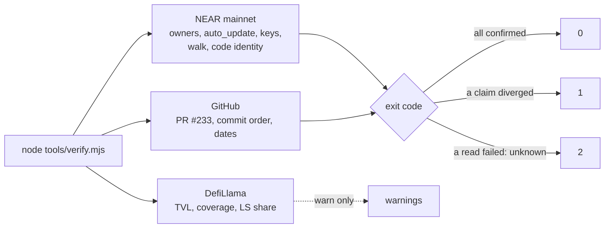

Exit codes: **0** every claim confirmed; **1** a claim diverged from mainnet;
**2** a read failed, so a claim is unknown (never counted as confirmed). Dollar
figures come from DefiLlama, are dated by the read, and never change the exit
code. What `verify.mjs` re-runs, and what is documented but not re-run (with
the command to reproduce it by hand), is listed in §0 of the spec.

`verify.mjs` makes only two unauthenticated GitHub calls; if GitHub rate-limits
you, it reports those claims as unknown (exit 2), not failed. Wait for the
reset time it prints and re-run.

```bash
npm test
```

Runs the test suite offline, against mainnet responses recorded in
`test/fixtures/`. Tests name the invariants (§10 of the spec) they check.

---

## The site

Five pages, one question each. Every page reads NEAR mainnet and DefiLlama from
your browser, with no server in between, and shows when each figure was read.

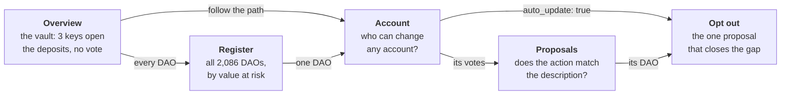

| page | the question | how it answers | the diagram |
|---|---|---|---|
| **Overview** | Is this real, and how big? | Counts the factory's keys live, reads the three DAOs' `auto_update`, values the deposits on DefiLlama | a vault with one keyhole per key; the path in 3D (keys → factory → DAOs → deposits, the vote skipped); the census as three blocks of squares (1,607 / 13 / 466) |
| **Account** | Who can change *this* account without a vote? | Walks keys, owner (five getters, in order), global contract, factory and policy, up to six hops | a tower: the value on top, each account a floor, the keys as the foundation, a red crack where no vote stands |
| **Proposals** | Does what members vote on match what it does? | Decodes all 17 proposal kinds and runs nine checks against the description | each proposal as a document, with every flag stamped in its margin |
| **Register** | Where is the value, and who can move it? | Ranks every DAO the factory lists by the value it administers | a treemap of administered value, red where the factory can replace the code |
| **Opt out** | How does a DAO close the gap today? | Drafts `FactoryInfoUpdate`, shows what is given up and who must approve, confirms only by re-reading | the fourth lock beside the factory's three keys, shut only when the chain reads `false` |

### The Account page

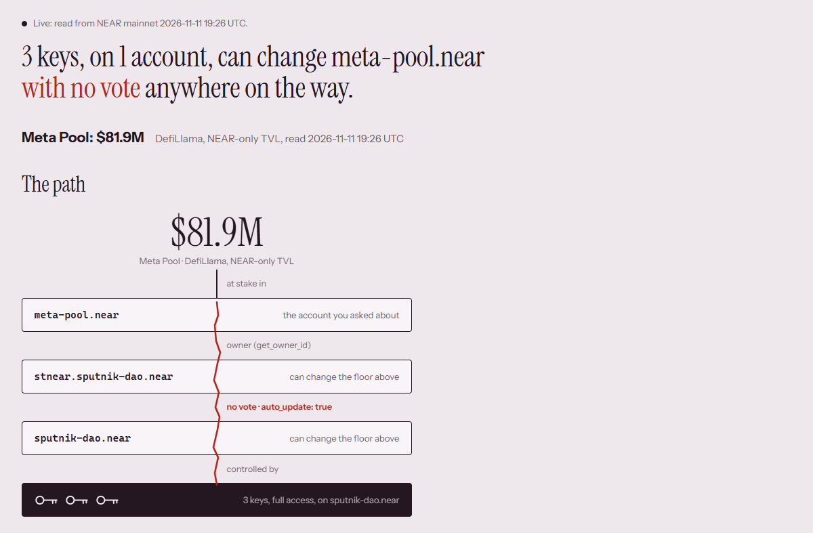

`meta-pool.near`, read live: its owner is `stnear.sputnik-dao.near`, which
reads `auto_update: true`, so the factory `sputnik-dao.near` can replace its
code, and the factory answers only to its three full-access keys. Every floor is
a link to that account's own path. Below the tower, the path in words, and the
two routes into the DAO's code: the one members can stop and the one they
cannot.

**How the walk decides each edge.** A failed read never becomes "no edge":

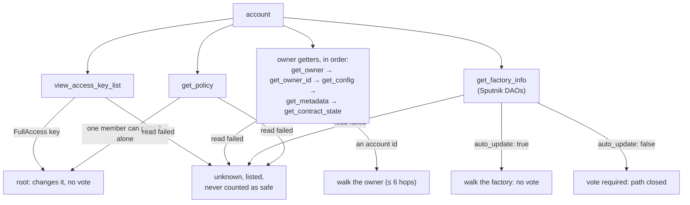

### Proposals: the check that caught a real pattern

On Burrow's DAO, #1743 repeats the description of #1741 and #1744 that of #1742,
each with a different receiver; Docket flags both `sibling-collision`.
Each proposal is checked like this, and a clean result is never called safe:

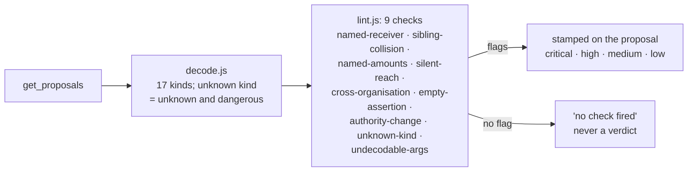

### Try it locally

**Built (Node 22.12 or later):**

```bash
npm run build                      # installs app/ from its lockfile, builds to dist/
npm run preview                    # serves dist/ at http://localhost:4173
```

| do | see |
|---|---|
| Open http://localhost:4173 | The finding in one sentence. It starts from values recorded on 2026-11-06, labelled as recorded, then switches to live figures with their read times. |
| Click "auto_update: false", then "Turn the keys" | The same keys turn, but the update is rejected and the door stays shut. This replays the mainnet opt-out test (transaction `772n4Z…`), not any DAO's current state. |
| Turn off the network and reload | The headline keeps the recorded values and names each read that failed. Unread values show as "unknown", never as zero. |

`dist/` is static (HTML, JS, CSS, fonts, the tool pages and `graph.json`) and
ready for Vercel or Netlify: the build command is `npm run build`, the output
directory `dist`. For development, run `npm run app:install` once, then
`npm run dev`.

**Without building.** The pages also work with no build at all. Serve the
**repository root**, because the census loads `graph.json` from there:

```bash
python -m http.server 8000
```

| page | what it shows |
|---|---|
| http://localhost:8000/web/index.html | the static version of the homepage: the same vault, reads and figures |
| http://localhost:8000/web/account.html?account=meta-pool.near | who can change any account without a vote, drawn as a path |
| http://localhost:8000/web/docket.html?dao=burrow.sputnik-dao.near | a DAO's proposals, decoded and checked against their descriptions |
| http://localhost:8000/web/register.html | every Sputnik DAO the factory lists, by reach |
| http://localhost:8000/web/optout.html?dao=stnear.sputnik-dao.near | the fix a DAO can apply today: one proposal setting `auto_update` to `false` |

Any static server works (`npx serve .`, for example); Python is only one option.

---

## How it works

### Two layers

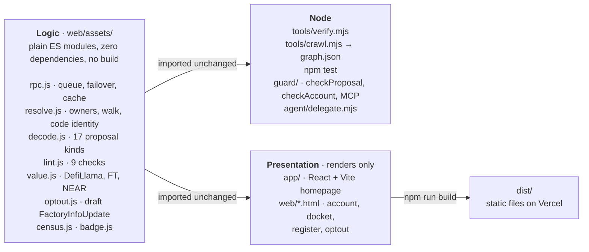

The logic (`web/assets/`, `tools/`, `guard/`, `agent/`) has no dependencies and
runs in Node 22 or a browser as it is: `node tools/verify.mjs` and `npm test`
need no install. The presentation (`app/`) may use pinned npm packages, but it
only renders: it imports the logic and never reimplements a read, a figure or a
rule. `test/app.test.mjs` enforces that.

**Libraries in the site, all pinned in `app/package-lock.json`:** React 19.3.1
and React DOM 19.3.1, built with Vite 8.3.7 and @vitejs/plugin-react 6.3.0, all
MIT. Fonts: Instrument Serif and Instrument Sans, self-hosted in
`web/assets/fonts` (SIL OFL). None of these are used by `verify.mjs`, the tests,
`guard/` or `agent/`. One more library is loaded at runtime and only on request:
NEAR Wallet Selector 10.1.4 (MIT), fetched from esm.sh when you click "Connect a
wallet" on the opt-out page. The mainnet transactions in this README were signed
with `near` (near-cli-rs), run by hand; it is a CLI, not a dependency.

**No backend, deliberately.** The claim is that anyone can check this
themselves; a server between reader and chain would weaken exactly that.

### A page load

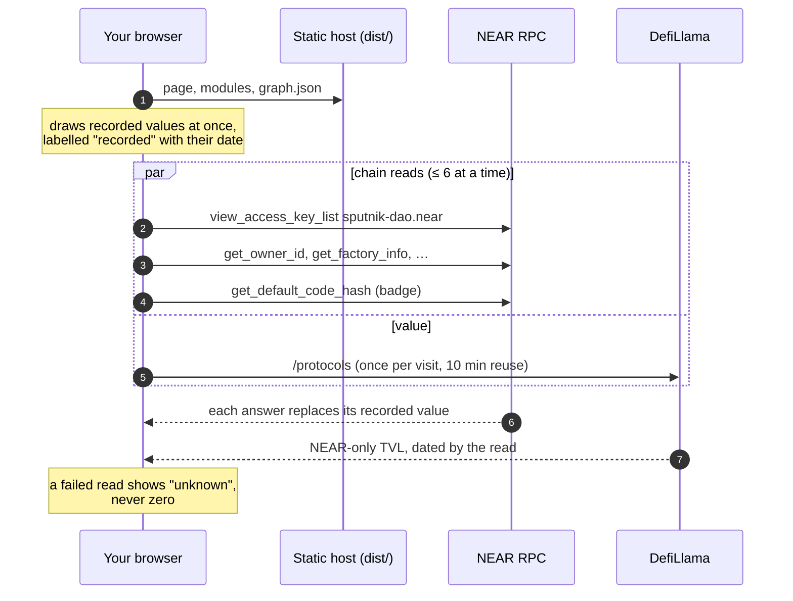

### RPC: measured, not assumed

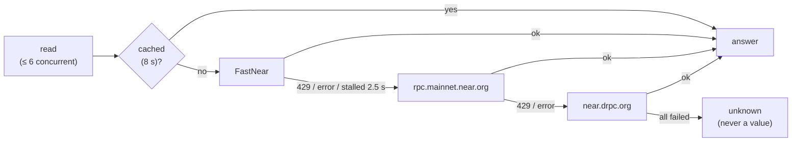

Concurrency is capped at 6 (24 trips FastNear's limiter; 6 does not). A 429
fails over at once, and that endpoint moves to the back of the order for 5 s.
`1rpc.io/near` is not used: it does not implement `query`.

### Invariants

The spec (§10) lists twenty invariants; each one that applies has a test that
names it. The ones that matter most:

| # | invariant |
|---|---|
| I1 | No number is invented; each traces to a call or a named source with a date |
| I2 | A failed read renders as "unknown", never as zero, absent, or false |
| I7 | An unknown proposal kind renders **unknown and dangerous** |
| I9 | The classifier flags and never clears; no "safe" verdict and no score |
| I10 | Base-unit amounts use BigInt; `Number` never touches one |
| I13 | Docket never signs. No private key exists anywhere under `web/` or `guard/` |
| I15 | An opt-out is confirmed by re-reading `get_factory_info`, never by the transaction succeeding |
| I16 | The delegate never votes on a proposal carrying any critical or high flag, any unknown, or a kind outside `policy.json` |
| I17 | The delegate's key is `FunctionCall`, receiver = its one DAO, methods = `["act_proposal"]` |
| I19 | The "fix shipped?" badge is a live read, never a stored value |
| I20 | The opted-out counter is computed from reads, with its denominator and unknown bucket |

---

## The fix: opting out

One `FactoryInfoUpdate` proposal, passed by the DAO itself, sets `auto_update`
to `false`. After that, `update()` from the factory is rejected.

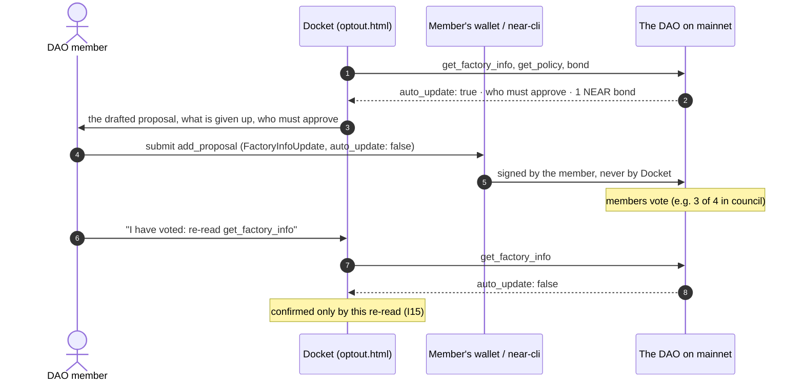

**What is given up**, shown above the submit button on the page:
(a) the factory can no longer rescue a DAO a migration has bricked; and
(b) `UpgradeSelf` no longer works on its own. Upgrading then takes three
proposals: `auto_update` back to `true`, the `UpgradeSelf`, and `auto_update`
back to `false`, with the no-vote path open in between. (b) was confirmed on
mainnet at v3.2.

The page can hand the transaction to your own wallet through NEAR Wallet
Selector, which it loads from esm.sh only when you click "Connect a wallet". It
also prints the same transaction as a `near-cli` command. Drafting refuses v3.0
DAOs (untested at that version), so it drafts nothing for `stader-nearx`.

---

## The delegate: an AI voter that cannot vote past a flag

`@docket/guard` exposes Docket's two checks, `checkProposal` and
`checkAccount`, as a JS library and as an MCP server, so any agent can run them
before it acts. The delegate is a council member whose only key can call
`act_proposal` on one DAO.

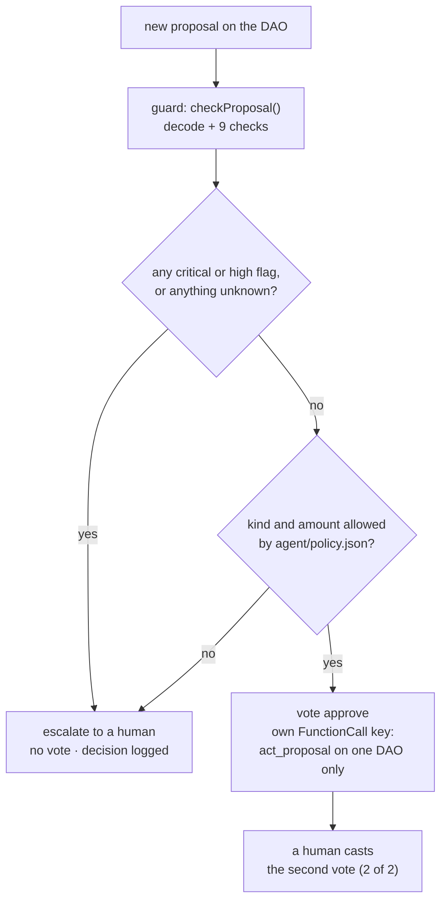

`agent/policy.json` allows `ChangeConfig` and native-NEAR `Transfer` up to
0.5 NEAR whose description names the amount. Everything else escalates. Kinds
rated critical or high are refused even if listed.

---

## Tools

| command | what it does |
|---|---|
| `node tools/verify.mjs` | re-reads the spec's claims from mainnet, GitHub and DefiLlama |
| `node tools/crawl.mjs` | the census: every DAO the factory lists, written to `graph.json`. Resumable; `--fresh` re-reads all of them (about 25 minutes) |
| `node tools/demo-dao.mjs <you.near>` | prints the transactions of the demo-DAO opt-out test (spec §16.5). Read-only: you sign them yourself |
| `node tools/receipts.mjs <tx> <signer> --step 5\|9` | judges that test from a transaction's receipts |
| `node tools/capture-fixtures.mjs` | re-records the mainnet responses the tests replay |
| `node tools/seed.mjs` | records the answers the account and docket pages show before their live read |
| `node guard/mcp.mjs` | Docket's two checks, `check_proposal` and `check_account`, as MCP tools over stdio (spec §17.1) |
| `node agent/delegate.mjs --account <delegate.near> [--dry-run]` | the delegate (spec §17.2): checks each new proposal and votes only on a clean one that `agent/policy.json` allows, signing with its own FunctionCall key from the OS keychain; otherwise it escalates to a human. `--dry-run` signs nothing |
| `node tools/guard-setup.mjs [--pre T<n>]` | prints the delegate's setup and demo transactions T1–T9, with a read-only pre-check for each |

---

## What has been run on mainnet

### The opt-out, tested on a demo DAO

On 2026-11-06 Docket created `docket-demo.sputnik-dao.near`, opted it out, and
approved the same `UpgradeSelf` twice:

| `auto_update` | the factory's update | transaction |
|---|---|---|
| `false` | **rejected** (`ERR_MUST_BE_SELF_OR_FACTORY`) | [`772n4ZWM…`](https://nearblocks.io/txns/772n4ZWMRtmXwsWuVTSP5F1UkbZ27UNyM9SqVzgXnXFS) |
| `true` | **ran** | [`EZw51V5k…`](https://nearblocks.io/txns/EZw51V5kCMeCCMsmNw5WqDsSUK8R2CHs4WyeK4jTtB1b) |

Every transaction is listed in the spec, §16.5. Signing an opt-out through a
browser wallet has not been run yet; the `near-cli` path has.

### The delegate, on the demo DAO

On 2026-11-08 the demo DAO got a second council member,
`docket-guard.docket-aditi.near`. Its only key is a FunctionCall key that can
call `act_proposal` on the demo DAO and nothing else (I17; `verify.mjs`
re-reads it). With two members, every proposal needs both votes. Then two
proposals with the same words, "Send 0.01 NEAR to docket-aditi.near (Docket
test)", were put to it:

- **#7 sends the 0.01 NEAR to docket-aditi.near, as it says.** The delegate
  found no flags and voted to approve, signing with its own key:
  [`HnMopqHK…`](https://nearblocks.io/txns/HnMopqHKJaJ7jJNY4sWkHoYJH6TLwZnVFmNzPh9ur6wZ).
  The human vote passed it:
  [`41FThx6G…`](https://nearblocks.io/txns/41FThx6G6n8osp4bRqtPfvpCa4VRr83Wu6obUosvcG72).
  Decision log: [`agent/log/docket-demo.sputnik-dao.near-7.json`](agent/log/docket-demo.sputnik-dao.near-7.json).
- **#8 sends it to docket-guard instead.** It was proposed in
  [`oE8yyRjD…`](https://nearblocks.io/txns/oE8yyRjDfWRLLWj6usvaxiVFawZLHcS9UTZ76v4JGfH).
  Its kind is allowed and its amount is under the cap, but Docket's checks raised
  three high flags: named-receiver, silent-reach, and a sibling collision with
  #7. The delegate did not vote, and escalated it to a human. Decision log:
  [`agent/log/docket-demo.sputnik-dao.near-8.json`](agent/log/docket-demo.sputnik-dao.near-8.json).

Every transaction of the setup and the demo, including three first attempts at
#7's vote that never reached the chain, is in the spec, §17.5.

### Reported before publishing

Before this repository was public, the finding went to NEAR security (asked to
forward it to the sputnik-dao-contract maintainers), Meta Pool and Stader.
LiNEAR has been asked for a private security contact and has not yet been sent
the details. [REPORT.md](REPORT.md) has the text that was sent, to whom, when,
and every reply.

---

## Repository layout

```
docket/
├── ARCHITECTURE.md      the spec: every claim, its command, its date; §12 corrections
├── REPORT.md            what was reported, to whom, when, and every reply
├── graph.json           the committed census (tools/crawl.mjs), regenerable
├── web/
│   ├── *.html           account, docket, register, optout (+ the static homepage)
│   └── assets/          the logic: rpc, resolve, decode, lint, value, optout, census, badge, …
├── app/                 the homepage: React + Vite, renders only; pinned lockfile
├── tools/               verify, crawl, demo-dao, receipts, capture-fixtures, seed, guard-setup
├── guard/               @docket/guard: checkProposal, checkAccount, and the MCP server
├── agent/               the delegate, policy.json, decision logs
├── test/                node --test suites, replaying recorded mainnet responses
└── docs/screenshots/    the images in this README
```

---

## How this was built

Docket was written with **Claude Code**, Anthropic's coding agent, running
Claude models, under the direction of its author. That covers the code, the
tests and the documents. The author decided what to build, reviewed it, and
sent the disclosure. The author approved every mainnet transaction, one at a
time. Most were signed by the author. For the last steps, T7–T9 of §17, Claude
Code ran each command after the author's explicit yes, and the signing used the
author's OS keychain. The delegate's vote on #7 was signed by the delegate's own
FunctionCall key, also from the keychain. No key was ever shown to, or handled
by, the agent. Every number in the spec traces to a read that `verify.mjs`, the
crawl or a documented command can repeat.

## NEAR HACKATHON

Built for NEAR HACKATHON (development 2026-11-01 to 2026-11-14 UTC). This is a
new repository: its first commit is 2026-11-05, so all of it was written in the
hackathon window and there is no pre-hackathon baseline to diff against.

- **Tracks:** Social Money (Sputnik DAO), AI Security & Defense (the delegate:
  a function-call key for one method on one DAO), Open Innovation.
- **Hosted demo:** [doc-ket-project.vercel.app](https://doc-ket-project.vercel.app),
  a static build of this repository (`vercel.json`), with no server of its own.
- **What the judges can run:** `node tools/verify.mjs` and `npm test` with no
  install; the site with `npm run build && npm run preview` (above).
- **Libraries:** listed under [Two layers](#two-layers). **AI tooling:** see
  [How this was built](#how-this-was-built).

## License

MIT. See [LICENSE](LICENSE).
